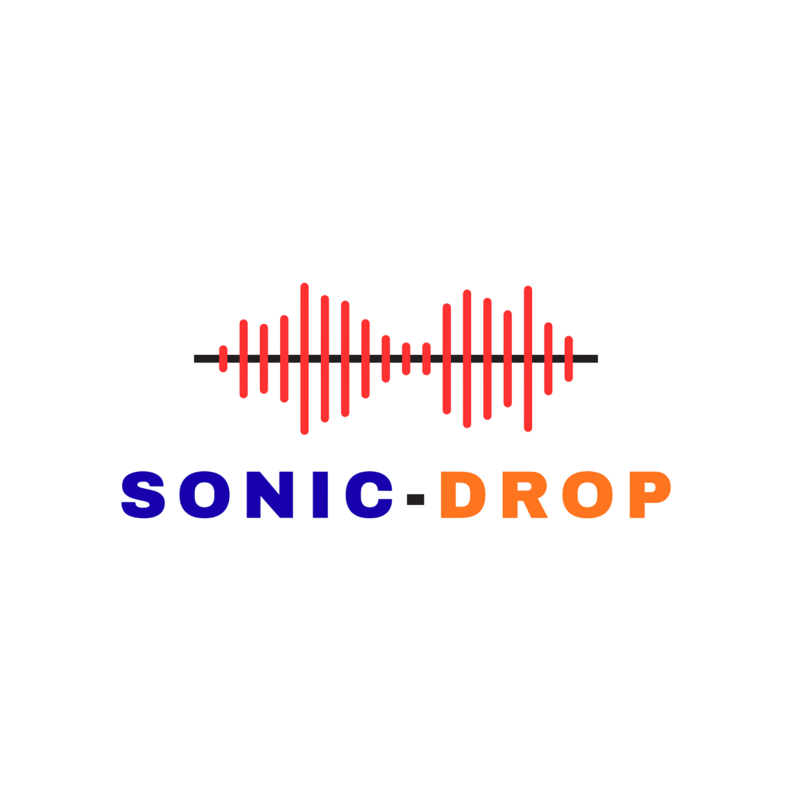

# 🔊 Sonic-Drop

<p align="center">
  
</p>

<p align="center">
  <b>Near-Ultrasonic Acoustic Air-Gapped Data Transfer Protocol & Android Application</b>
</p>

<p align="center">
  
  
  
  
  
  
</p>

---

## 📌 Executive Summary

**Sonic-Drop** is an offline, air-gapped data transfer engine that facilitates device-to-device communication entirely through near-ultrasonic acoustic sound waves (17.5 kHz – 20.5 kHz). 

It operates completely isolated from Wi-Fi, Bluetooth, NFC, or cellular networks. By relying solely on physical acoustic transducers (speaker and microphone), Sonic-Drop is immune to RF eavesdropping, electromagnetic spectrum sniffing, and network-level packet sniffing.

---

## 🛡️ Cryptographic & Security Architecture

Sonic-Drop implements an end-to-end authenticated, forward-secret cryptographic envelope designed to withstand Man-in-the-Middle (MITM) and replay attacks:

```
[ Sender Device ]                                      [ Receiver Device ]
       │                                                       │
       ├────────── 1. Ephemeral X25519 PubKey (SYN) ──────────>│
       │                                                       │
       │<─────── 2. Ephemeral X25519 PubKey (SYN_ACK) ────────┤
       │                                                       │
[ Compute Shared Secret ]                              [ Compute Shared Secret ]
[ HKDF-SHA256 Session Key ]                            [ HKDF-SHA256 Session Key ]
       │                                                       │
       ├─────────── 3. Short Authentication String ────────────┤
       │                    (6-Digit SAS Code)                 │
       │              [ Visual Comparison by Users ]           │
       ▼                                                       ▼
[ Encrypt Payload with ChaCha20-Poly1305 ]             [ Decrypt & Authenticate Tag ]
[ Unique 12-byte Directional Nonce ]                   [ Enforce Sequence Ordering ]
[ Transmit Reed-Solomon + CRC16 Frame ]                [ Validate CRC & RS Correction ]
```

1. **Ephemeral Key Agreement (X25519 / ECDH)**: Every session generates fresh, ephemeral cryptographic key pairs. Private keys never leave memory or touch the physical channel.
2. **Key Derivation (HKDF-SHA256)**: RFC 5869 extract-and-expand ensures high-entropy 256-bit symmetric session keys bound to session context.
3. **Short Authentication String (SAS)**: Mitigates acoustic Man-in-the-Middle attacks. Both devices deterministically compute and display an identical 6-digit verification code for mutual confirmation before encrypted data flows.
4. **AEAD Encryption (ChaCha20-Poly1305)**: Every packet payload is encrypted and authenticated. 
5. **Replay & Injection Protection**: Unique 12-byte deterministic nonces bound to session ID, monotonic sequence numbers, and directional indicators.

---

## 🎛️ Acoustic DSP & Modulation Engine

The physical transmission layer is written in modern **C++20** and compiled via Android NDK for deterministic low-latency execution:

```
  Frequency (Hz)
    20.5 kHz ──── Preamble Sync Tone 2 / Mark Tone (High)
    19.5 kHz ──── Space Frequency (Binary 0)
    18.5 kHz ──── Mark Frequency (Binary 1)
    17.5 kHz ──── Preamble Start Tone 1
```

* **Continuous-Phase Binary FSK (CP-FSK)**: Smooth phase transitions across bit boundaries eliminate acoustic splatter and audible clicks.
* **Goertzel Spectral Filtering**: Ultra-lightweight single-bin discrete Fourier transform filter banks detect preambles and decode symbols in real time without CPU-heavy whole-spectrum FFT overhead.
* **Sliding Preamble Detection**: 4-stage alternating sync sequence (`[F1, F2, F1, F2]`) provides robust packet boundary alignment even in presence of room echoes.
* **KissFFT Diagnostics**: Provides real-time Fast Fourier Transform spectral analysis and SNR (Signal-to-Noise Ratio) measurement.
* **Reed-Solomon FEC (N, K)**: Operates over Galois Field $GF(2^8)$ to correct up to 4 corrupted symbol bytes per packet frame.

---

## ⚡ Performance & Transfer Characteristics

Acoustic communication propagates data entirely through **sound waves** in the near-ultrasonic spectrum (18.5 kHz – 20.5 kHz). Because it operates within a tight ~2 kHz acoustic slice to maintain human inaudibility and withstand room reverberation, its throughput characteristics are optimized for **high-security credentials, cryptographic keys, and air-gapped text data**:

### 📊 Physical Layer Throughput:
* **Modulation Scheme**: Continuous-Phase Binary FSK (CP-FSK)
* **Symbol Duration**: 10 ms per symbol (100 Baud)
* **Raw Acoustic Speed**: ~100 bits/sec (~12.5 Bytes/sec)
* **Net Effective Speed**: **~8 to 10 Bytes/sec** (after Preamble, Reed-Solomon (N,K) FEC, CRC-16, and ChaCha20-Poly1305 overhead)

### ⏱️ Estimated Transfer Times by Payload Size:

| Payload Type | Typical Size | Transfer Time | Practical Use Case |
| :--- | :--- | :--- | :--- |
| **X25519 Session Handshake + SAS** | ~32 – 64 B | **~4 – 6 Seconds** | ✅ Seamless mutual verification |
| **OTP / Passwords / 2FA Tokens** | 6 – 16 B | **~2 – 3 Seconds** | ✅ Instant air-gapped MFA |
| **Crypto Wallet Seed / Private Key** | 32 – 128 B | **~8 – 15 Seconds** | ✅ Cold storage wallet recovery |
| **Encrypted Short Text / Notes** | 250 – 500 B | **~30 – 60 Seconds** | ✅ Zero-network secret memos |
| **Small File / Contact Card** | 1 KB – 2 KB | **~1.5 – 3.5 Minutes** | ✅ Offline transfer |
| **Large Files / Media (MBs)** | > 100 KB | **Hours (Impractical)**| ❌ *Use RF protocols (Wi-Fi Direct)* |

> [!NOTE]  
> Sonic-Drop is purposely engineered for **military-grade air-gapped security, classified credential transfer, and zero-RF device pairing** where total radio silence (No Wi-Fi, No Bluetooth, No Cellular) is required. Large multimedia files (MBs) are not suited for ultrasonic sound-wave transmission due to acoustic physical limits.

---

## 📱 Environmental & Physical Device Guidelines

To ensure seamless, error-free ultrasonic communication between two physical Android devices:

1. **Optimal Distance**: Keep devices between **5 cm to 50 cm** apart (e.g., resting next to each other on a table).
2. **Speaker Volume**: Set media volume on the transmitting device to **70% – 90%**. Extremely low volume prevents microphone detection, while 100% can cause hardware harmonic distortion.
3. **Microphone Placement**: Ensure the receiver's bottom microphone is not obstructed by hands or thick cases.
4. **Sample Rate**: The app automatically negotiates **48,000 Hz (48 kHz)** mono float PCM, supported natively across modern Android devices.

---

## 🏗️ End-to-End System Architecture

```
               [ User Data / File ]
                         │
                         ▼
        ┌──────────────────────────────────┐
        │   Storage Access Framework / SAF │
        └──────────────────────────────────┘
                         │
                         ▼
        ┌──────────────────────────────────┐
        │    X25519 + ChaCha20-Poly1305    │  (AEAD Encryption & Unique Nonces)
        └──────────────────────────────────┘
                         │
                         ▼
        ┌──────────────────────────────────┐
        │        Packet Formatter          │  (Type, Session ID, Sequence No)
        └──────────────────────────────────┘
                         │
                         ▼
        ┌──────────────────────────────────┐
        │     CRC-16 & Reed-Solomon        │  (Error detection & FEC redundancy)
        └──────────────────────────────────┘
                         │
                         ▼
        ┌──────────────────────────────────┐
        │     CP-FSK Native Modulator      │  (18.5 kHz Mark / 19.5 kHz Space)
        └──────────────────────────────────┘
                         │
                         ▼
            [ Device Speaker / Transmit ]
                         ~ 🔊 ~  (Acoustic Channel)
           [ Device Microphone / Receive ]
                         │
                         ▼
        ┌──────────────────────────────────┐
        │   Lock-free Audio Ring Buffer    │
        └──────────────────────────────────┘
                         │
                         ▼
        ┌──────────────────────────────────┐
        │    Preamble Detector (Goertzel)  │  (Sync detection & Energy peak)
        └──────────────────────────────────┘
                         │
                         ▼
        ┌──────────────────────────────────┐
        │       CP-FSK Demodulator         │  (Symbol decision & bit extraction)
        └──────────────────────────────────┘
                         │
                         ▼
        ┌──────────────────────────────────┐
        │   Reed-Solomon Decode & Verify   │  (Error correction & CRC check)
        └──────────────────────────────────┘
                         │
                         ▼
        ┌──────────────────────────────────┐
        │     ChaCha20-Poly1305 Decrypt    │  (Authenticated Payload Decryption)
        └──────────────────────────────────┘
                         │
                         ▼
             [ Verified Output File ]
```

---

## 📂 Project Structure

```
SONIC-DROP/
├── app/
│   ├── src/
│   │   ├── main/
│   │   │   ├── cpp/                      # Native C++ DSP Core
│   │   │   │   ├── dsp/                  # FSK Modulator, Demodulator, Audio Buffer, Preamble Detector
│   │   │   │   ├── fec/                  # Reed-Solomon Codec GF(2^8)
│   │   │   │   ├── protocol/             # Packet serialization & CRC16
│   │   │   │   ├── third_party/kissfft/  # KissFFT spectral analysis library
│   │   │   │   ├── CMakeLists.txt        # Native build config
│   │   │   │   └── native-lib.cpp        # JNI Export interfaces
│   │   │   ├── java/com/sonicdrop/
│   │   │   │   ├── audio/                # NativeDspBridge & AudioController (AudioTrack/Record)
│   │   │   │   ├── protocol/             # Binary Packet Models & Enums
│   │   │   │   ├── security/             # X25519, HKDF-SHA256, ChaCha20-Poly1305, SAS
│   │   │   │   ├── transfer/             # TransferManager & State Machine
│   │   │   │   ├── theme/                # Minimal Charcoal & Electric Blue Design Tokens
│   │   │   │   └── ui/main/              # SonicDropApp Jetpack Compose UI
│   │   │   └── res/                      # Adaptive Launcher Icons & Resources
│   │   └── test/                         # Unit tests (SonicCryptoTest, etc.)
│   └── build.gradle.kts
├── docs/
│   └── assets/                           # Logo and architectural diagrams
├── SonicDrop-debug.apk                   # Pre-compiled ready-to-install Android APK
└── README.md
```

---

## 📲 Direct APK Download & Installation

You can directly download and install the pre-compiled APK from the root of this repository:

📥 **[Download SonicDrop-debug.apk (Direct Link)](SonicDrop-debug.apk)**

Or install directly onto a connected physical Android device via ADB:
```bash
adb install -r SonicDrop-debug.apk
```

---

## 🚀 Getting Started

### Prerequisites
- **Android Studio**: Hedgehog (2023.1.1) or newer
- **Android NDK**: Version `25.x` or higher
- **CMake**: Version `3.22.1` or higher
- **Target SDK**: Android 14 (API 34)
- **Minimum SDK**: Android 8.0 (API 26)

### Build from Source
1. Clone the repository:
   ```bash
   git clone https://github.com/Rohanjm911/Sonic-Drop.git
   cd Sonic-Drop
   ```
2. Open the project in Android Studio.
3. Allow Gradle to sync and download necessary NDK/CMake components.
4. Run unit tests:
   ```bash
   ./gradlew testDebugUnitTest
   ```
5. Build the debug APK:
   ```bash
   ./gradlew assembleDebug
   ```
   The built APK will be located at `app/build/outputs/apk/debug/app-debug.apk` and root `SonicDrop-debug.apk`.

---

## 📄 License

This project is licensed under the MIT License - see the LICENSE file for details.